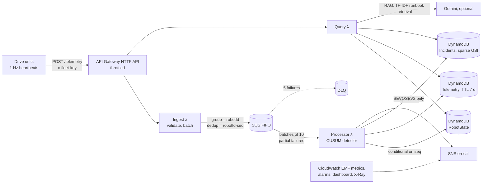

# FleetOps

**Serverless telemetry, anomaly detection and on-call triage for a warehouse robot fleet on AWS.**
Java 21 Lambdas, SQS FIFO, DynamoDB, SNS and CloudWatch are defined as one AWS CDK (TypeScript)
stack. The service includes a streaming CUSUM fault detector and a retrieval-augmented LLM
assistant that drafts first-response steps from the runbook.

**Dashboard: https://nags-gk.github.io/fleetops/** shows a replay of a simulated shift. Add `?api=<your API URL>` to watch a live deployment.

[](https://github.com/Nags-gk/fleetops/actions/workflows/ci.yml)

## Architecture



| Concern | How it is handled |
|---|---|
| **Ordering** | SQS FIFO message group per robot. The detector is sequential per robot while robots are processed in parallel ([ADR 0001](docs/adr/0001-sqs-fifo-over-kinesis.md)). |
| **Idempotency** | SQS de-duplication id `robotId-seq`, plus a DynamoDB conditional write `seq < :seq`. Duplicates and late samples are dropped and counted. |
| **Fault tolerance** | Partial batch responses retry only failed messages. Poison payloads are dropped and counted. Five failures send a message to a DLQ, which raises an alarm. |
| **Fault detection** | Hard limits (over-temperature, critical battery, error codes), a stuck-drive timer, and CUSUM drift detection on each robot's own EWMA baseline. Only settled MOVING samples are used, and adaptation pauses during a suspected drift. |
| **Alert hygiene** | One incident per (robot, kind) while open; repeats increment `occurrences` instead of paging. SEV3 opens a ticket only. |
| **On-call** | `POST /incidents/{id}/triage` retrieves runbook sections (TF-IDF) and summarises the last 10 minutes of telemetry. It asks an LLM for a grounded plan, with a strict "only recommend runbook actions" prompt, and falls back to the retrieved steps if no model is configured or it times out. |
| **Observability** | CloudWatch Embedded Metric Format (no PutMetricData calls on the hot path), four alarms wired to the on-call topic, a dashboard, and X-Ray tracing. |
| **Cost and security** | Free-tier-sized design, API throttling (50 rps, burst 100), a $5 AWS Budget alert, least-privilege IAM grants per function, and a constant-time API-key check. |
| **Cold starts** | SnapStart on the API-facing functions behind a `live` alias, with no framework ([ADR 0003](docs/adr/0003-lambda-java-snapstart.md)). |

## Detector results

From `results/detector_eval.json`, produced by `mvn exec:java -Dexec.args="evaluate 200 120 7"`:
200 simulated robots over 2 hours (1,440,000 heartbeats), with 61 labelled faults injected after a 5-minute warm-up.

| Fault | Detected |
|---|---:|
| Battery drain | 9/9 |
| Bearing wear (slow temp + current drift) | 9/9 |
| Lidar fault (E101) | 19/19 |
| Motor overheat | 10/10 |
| Stuck drive | 14/14 |

* **Recall:** 100% (61/61). Median time to detect is **20 s** and p95 is 114 s.
* **False alarms:** **zero false pages**. There were 4 false SEV3 tickets, or 0.01 per robot-hour.
* **Alert de-duplication:** 8,025 raw anomalies were folded into 82 incidents and 52 pages, about 98 anomalies per incident.
* **Throughput:** about **150k heartbeats/s** on one core (detector + in-memory store, excluding I/O).

How the detector got there, as measured:

1. A first version with plain z-scores produced 1.0 false incidents per robot-hour, triggered by load changes.
2. Switching to CUSUM and judging only settled MOVING samples did not help at first.
3. A selection-bias bug was the real cause: the baseline learned only from in-control samples. Fixing it cut false incidents to 0.04 per robot-hour.
4. Running-average warm-up brought it to 0.01.

## Tests

```bash
mvn verify                                    # 17 unit tests: detector, processor, ingest, API, RAG, regression
moto_server -p 5055 &                         # local AWS emulator
MOTO_ENDPOINT=http://localhost:5055 mvn verify  # + 3 integration tests: real AWS SDK v2 calls
cd infra && npm ci && npm test                # 5 CDK assertion tests on the synthesized CloudFormation
```

CI runs all of the above on every push, re-scores the detector, synthesizes the stack and publishes the dashboard.

## Live deployment

Deployed with `./deploy.sh` to us-east-2 (AWS free plan). The API is
`https://i5nmbvd3u4.execute-api.us-east-2.amazonaws.com`; watch it at
[nags-gk.github.io/fleetops/?api=…](https://nags-gk.github.io/fleetops/?api=https://i5nmbvd3u4.execute-api.us-east-2.amazonaws.com).

A 12-minute run of `./load.sh 30 12` (30 simulated robots, 9 injected faults) against the live stack:
**9/9 faults detected with zero false incidents**. The dead-letter queue stayed empty and all four alarms stayed OK.

## Deploy to your AWS account

```bash
./deploy.sh you@example.com            # builds, bootstraps CDK, deploys, prints API + dashboard URLs
./load.sh 50 15                        # 50 simulated robots with injected faults for 15 minutes
(cd infra && npx cdk destroy FleetOps -c ingestKey=x)   # tear down
```

You can also run the **Deploy to AWS** GitHub Actions workflow, using an OIDC role or access-key secrets.
Confirm the SNS email subscription to receive pages. If you signed in with `aws login`, export the
session first (`eval "$(aws configure export-credentials --format env)"`), since the pinned CDK CLI
does not read that credential type directly. An optional Gemini API key (`./deploy.sh email key`) turns on LLM triage.

## API

| Method | Path | |
|---|---|---|
| POST | `/telemetry` | `{"heartbeats":[...]}` with header `x-fleet-key`; up to 500 per request. Returns 202 (accepted), 422 (none valid), 401 or 503. |
| GET | `/fleet` | fleet summary and every robot's latest heartbeat |
| GET | `/robots/{id}/telemetry?since=` | time series (default last 10 minutes) |
| GET | `/incidents?limit=` | newest first |
| POST | `/incidents/{id}/triage` | RAG triage, stored on the incident |
| POST | `/incidents/{id}/resolve` | closes it and removes it from the open index |

## Layout

```
src/main/java/dev/nagsgk/fleetops/
  model/      Heartbeat, RobotState (+ detector stats), Incident, Anomaly
  detect/     AnomalyDetector (limits, CUSUM drift, stuck timer)
  ingest/ process/ triage/   application services (ports & adapters)
  store/ queue/ alert/       DynamoDB, SQS FIFO, SNS adapters + in-memory fakes
  api/        Lambda handlers (ingest, processor, query) and env wiring
  sim/        fleet simulator: fault injection, scoring, load generator, dashboard replay
src/main/resources/runbooks/   on-call runbook (also the RAG corpus)
infra/      AWS CDK stack (TypeScript) + assertion tests
web/        operations dashboard (GitHub Pages)
docs/adr/   architecture decision records
```

## Limitations

* Telemetry comes from a simulator with a simple thermal and electrical model. It is not from real drive units.
* The fleet and incident listings scan their tables, which is fine for demo fleets. A per-site GSI is the documented next step ([ADR 0002](docs/adr/0002-dynamodb-data-model.md)).
* Robots authenticate with a single shared key. A production fleet would use per-device credentials, for example IoT Core with X.509 certificates.

## License

MIT
